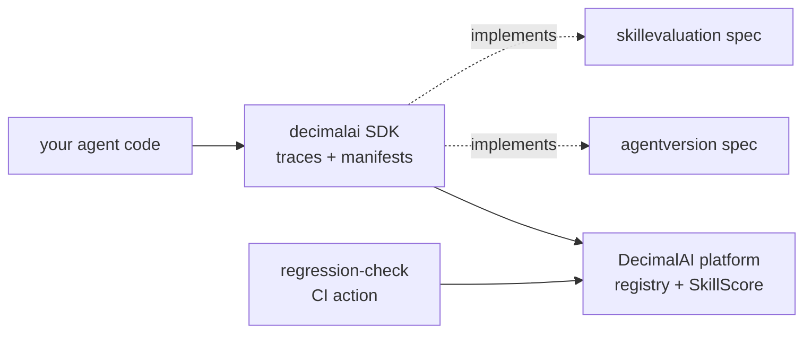

# DecimalAI Python SDK

**Catch what your next agent change will break** — a structural regression check against your recorded traces, built on manifest-aware versioning of your agent's tools, prompts, models, and skills. The open source SDK for [DecimalAI](https://decimal.ai).

[](https://pypi.org/project/decimalai/)
[](https://pepy.tech/project/decimalai)
[](https://github.com/decimal-labs/decimalai-python/actions/workflows/ci.yml)
[](https://pypi.org/project/decimalai/)
[](https://github.com/decimal-labs/decimalai-python/blob/main/LICENSE)
[](https://colab.research.google.com/github/decimal-labs/decimalai-python/blob/main/examples/support-agent/support_agent.ipynb)

[Docs](https://docs.decimal.ai) · [Registry](https://app.decimal.ai/skills) · [Leaderboard](https://app.decimal.ai/skills/leaderboard) · [Changelog](https://docs.decimal.ai/changelog)


## Installation

```bash
pip install decimalai
# or
uv pip install decimalai
```

Requires **Python 3.10+** (`pip` won't install current releases on older Pythons). The `[adk]`, `[pydantic-ai]` and `[all]` extras need **Python 3.11+**: the google-adk and pydantic-ai-slim releases they install require it. On Python 3.10 pip does not refuse them; it installs an older decimalai instead (see [below](https://github.com/decimal-labs/decimalai-python#when-pip-installs-an-older-decimalai)).

`[langchain]` installs on Python 3.10 with one limit there. asyncio on 3.10 cannot hand a run's config to an async LangGraph node, so a model that the node calls without passing `config` on, as `create_agent`'s model node does, runs outside the run. Under `ainvoke` / `astream` those model calls route without the agent the trace is filed under, so that agent's skills and pins are not offered, and the trace records neither the calls nor their routing decisions. The SDK logs a warning the first time it happens. Sync `.invoke()` runs, nodes that pass `config` to the model, and every run on Python 3.11+ are unaffected; `instrument(agent_name=...)` at least routes the calls as the right agent.

Each framework extra supports the framework's latest release only, and floors it there.

The core install is deliberately thin (tracing, CLI, manifests, skills). Framework and provider adapters ship as extras — install the one matching your stack:

```bash
pip install "decimalai[langchain]"       # LangChain (add [langgraph] for LangGraph)
pip install "decimalai[openai-agents]"   # OpenAI Agents SDK
pip install "decimalai[all]"             # every framework adapter (not [evals]; see below)
```

Available extras: `[langchain]`, `[langgraph]`, `[openai]`, `[openai-agents]`, `[llamaindex]`, `[claude-agent-sdk]`, `[pydantic-ai]`, `[adk]`, `[evals]`, `[all]`.

`[evals]` installs litellm, which pins `openai<3`, while `[openai]`, `[openai-agents]` and `[pydantic-ai]` need `openai>=3`. So `[evals]` is not part of `[all]`, and it cannot be installed in the same environment as those three. CrewAI has no extra for the same reason: install `crewai` yourself, beside the adapters that run on `openai<3`.

### When pip installs an older decimalai

Extras that cannot be installed together are not an error to pip. It goes back through older decimalai releases until one resolves, installs that, and prints nothing (`uv pip install` does the same). Two requests do this today, and both end on **decimalai 0.13.9**, the last release before the framework floors above, without this release's fixes:

- `[evals]` together with `[openai]`, `[openai-agents]`, `[pydantic-ai]` or `[all]`, on any Python.
- `[adk]`, `[pydantic-ai]` or `[all]` on Python 3.10.

Check the version you got, and put a floor on decimalai itself so pip names the conflict instead of falling back:

```bash
pip show decimalai                       # Version: 0.13.9 means pip fell back
pip install "decimalai[adk]>=0.14"       # fails with an error rather than install 0.13.9
```

## See it in 2 minutes

The regression demo seeds a reference agent (v1 → v2 + a trace corpus) into your workspace and runs the exact pipeline a real PR check runs. It needs a free API key — that's the only setup:

```bash
export DECIMAL_API_KEY="dai_sk_..."   # free key from app.decimal.ai/settings
decimalai demo regression             # → impact report: what your next change would break
```

The impact report it produces looks like this — captured with the SDK's `decimalai regression-check` against the seeded reference agent, trimmed:

```text
  🔍 Agent Regression Check — [Demo] support-agent

  Manifest changes:
    🟡 tool_renamed — lookup_price
    🟢 tool_added — refund_order
    🟡 prompt_section_rewritten — system_prompt  [major, 88.6% changed]
    🔴 model_changed — gpt-4o-mini  (gpt-4o-mini-2024-07 → gpt-4o-mini-2024-09)
    🔴 tool_removed — compare_competitors

  Training-data policy (default):
    prompt_section_rewritten (major) → replay — need re-running first
    model_changed (major) → drop — excluded from training
```

Everything above comes from a **seeded reference agent — illustrative, run it yourself**. On your own instrumented agent, each change is additionally checked against your recorded traces — a high/medium/low blast radius per trace, not just the structural diff. The API key is needed because the demo seeds data into a workspace on the platform; `decimalai demo reset` removes it all.

These commands work without a DecimalAI key:

- `decimalai skills pull <slug>` — copy any published skill's folder (SKILL.md and its bundled files) to disk, no account. `decimalai skills add <slug>` installs a public skill into a project instead, locked and updatable.
- `decimalai starter support --project ./support-agent` — download a frozen, runnable Support project. Its Python standard-library runtime uses your OpenAI key locally and uploads no traces; `python3 agent.py --check-setup` verifies the files and `--checks` makes two task and two judge calls. The [public builder](https://app.decimal.ai/skills/packs/support/build) downloads the same project without installing the SDK.
- The [`agentversion`](https://pypi.org/project/agentversion/) manifest flow ([below](https://github.com/decimal-labs/decimalai-python#open-standard-agentversion)) — diff and gate agent manifests fully locally.

There's a second demo for the registry side:

```bash
decimalai demo skills       # → tour the registry: security-scanned skills, benchmarkable with an open A/B spec
```

Browsing without an account? Explore the [public skill registry](https://app.decimal.ai/skills) — no signup required.

## Quick Start

### LangChain / LangGraph — Zero-Code Tracing and Skills

```python
import decimalai

# That's it — chains, graphs and agents are traced, and the agent's skills are
# routed into every chat-model call. skills=False keeps it to tracing only.
decimalai.init(langchain=True, agent_name="support")

# Use LangChain as normal — nothing else changes
from langchain_openai import ChatOpenAI
from langchain_core.prompts import ChatPromptTemplate

chain = ChatPromptTemplate.from_template("Tell me about {topic}") | ChatOpenAI(model="gpt-4o")
result = chain.invoke({"topic": "otters"})  # ← one trace, sent when the chain completes
```

A trace is sent when a **chain, agent, or graph run completes**. A bare `llm.invoke("Hello!")`
with no surrounding chain never reaches that boundary, so it sends nothing — wrap the call, or
see [manual tracing](https://docs.decimal.ai/sdk/python/frameworks/langchain) for the per-call
handler.

### OpenAI Agents SDK

```python
from agents import Agent, Runner
from decimalai.openai_agents import load_agent

support = load_agent("support", fallback=BASE_INSTRUCTIONS)   # reads DECIMAL_API_KEY

agent = Agent(
    name=support.name,
    instructions=support.instructions,    # the agent's saved prompt, then its skill list
    tools=[lookup_order, *support.tools], # + load_skill
)
result = Runner.run_sync(agent, "Where is ORD-1001?")
```

`load_agent()` reads the agent's prompt and keeps a local copy, re-read in the background, so a
prompt saved in the dashboard reaches the next run (within a minute) with no redeploy. Each run's
skill list is routed on that run's own message: the first run before its model call, later runs from
a local copy while their decision is recorded in the background, and an agent with more skills than
the menu holds before every model call. `{{placeholders}}` in the prompt are filled from
`Runner.run(..., context=...)`; a missing value stops the run before the model call. Nothing in the
OpenAI SDK is patched and other agents in the process are untouched. Each run is traced with its
prompt version and the skills offered, loaded and delivered. `init(openai_agents=True)` (or
`instrument()`) traces runs and changes no agent; skills come only from `load_agent()`.

### Pydantic AI

```python
from pydantic_ai import Agent
from decimalai.pydantic_ai import load_agent

support = load_agent("support", fallback=BASE_INSTRUCTIONS)   # reads DECIMAL_API_KEY

agent = Agent(
    "openai:gpt-5.4-mini",
    name=support.name,
    tools=[lookup_order],
    capabilities=[support],   # the agent's saved prompt, its skill list, and load_skill
)
result = agent.run_sync("Where is ORD-1001?", deps=customer)
```

`support` is a Pydantic AI capability: its instructions are the saved prompt (`{{placeholders}}`
filled from the run's `deps`), then the skill list routed on the run's prompt, and its toolset is
`load_skill`. It wraps each run in one DecimalAI run span, so a run's model calls are one trace filed
under the DecimalAI agent. Nothing in Pydantic AI is patched. Traces come from DecimalAI's OpenTelemetry
exporter: `decimalai.init(otel=True)` plus `Agent.instrument_all()` (Pydantic AI's own spans, any
provider), or a provider instrumentor such as `decimalai.init(openai=True)`; pick one.

### Google ADK

```python
from google.adk.agents import LlmAgent
from google.adk.apps import App
from google.adk.runners import InMemoryRunner
from decimalai.adk import DecimalaiPlugin, load_agent

support = load_agent("support", fallback=BASE_INSTRUCTION)   # reads DECIMAL_API_KEY

agent = LlmAgent(
    name="support_agent",                  # ADK's own name, a Python identifier
    model="gemini-3.5-flash",
    instruction=support.instruction,       # the agent's saved prompt, then its skill list
    tools=[lookup_order, *support.tools],  # + load_skill
)
app = App(name="support_app", root_agent=agent, plugins=[DecimalaiPlugin()])
runner = InMemoryRunner(app=app)
```

`support.instruction` is an ADK instruction provider: ADK calls it before each model request, and
each invocation's skill list is routed once, on that invocation's message. `{{placeholders}}` are
filled from the session's state (ADK fills no `{var}` of its own in a provider's text); a missing
value stops the run before the model call. `DecimalaiPlugin()` in the `App` makes each invocation one
trace, filed under the DecimalAI agent with its prompt version and the skills offered, loaded and
delivered; a runner built without it is not traced. Nothing in ADK is patched. An agent that carries
ADK's own `SkillToolset` gets no DecimalAI skills.

### Your own model calls

For code that calls a model itself (a provider SDK, your own tool loop), the top-level
`decimalai.load_agent()` hands over the same prompt and skills as plain values:

```python
import decimalai

support = decimalai.load_agent("support", fallback=BASE_PROMPT)

system = support.system(question, context=customer)  # the prompt, filled, then this turn's skill list
tools = [*my_tools, support.tool_spec]                # load_skill as {name, description, parameters}
# ...and when the model calls load_skill:
text = support.load_skill(tool_input["name"])
```

Each `system()` call is one turn, routed on its message the way an OpenAI Agents run is, with
`{{placeholders}}` filled from `context=`. `support.prompt` is the saved prompt as written, for code
that wants only the text.

`init(langchain=True)` and `init(crewai=True)` install the same thing as that adapter's `instrument(agent_name=..., enable_skill_loader=True)`. Use one or the other, not both.

### Any Framework — Manual Tracing

```python
import decimalai

decimalai.init()

@decimalai.trace(agent_name="my-agent")
def run_agent(query):
    msgs = [{"role": "user", "content": query}]
    resp = openai.chat.completions.create(model="gpt-4o", messages=msgs)
    decimalai.log_llm_call(
        model="gpt-4o",
        input=msgs,
        output={"content": resp.choices[0].message.content},
    )
    return resp.choices[0].message.content
```

### Environment Variable Setup (No Code Changes)

```bash
export DECIMAL_API_KEY=dai_sk_...
export DECIMAL_AUTO_TRACE=langchain   # or "openai-agents", "crewai", "llamaindex", ...
# export DECIMALAI_SKILLS=0           # tracing only: no skill routing, nothing added to prompts
# Just run your app — tracing and skills activate on import
python app.py
```

`DECIMAL_AUTO_TRACE=<framework>` runs the matching `decimalai.init()` framework flag at import. On `langchain` and `crewai` that includes the skill loader: each turn's message (on CrewAI, the task description) goes to the platform's router, and a skills menu (plus a skill body) is added to the prompt. `openai-agents` traces only; an OpenAI agent gets its skills from `load_agent()`. Google ADK has no flag: put `DecimalaiPlugin()` in your `App` ([above](#google-adk)). `DECIMALAI_SKILLS=0` (or `false`/`no`/`off`) keeps it to tracing; it is the default of `init(skills=...)`, so it applies to the flags in code too, and an explicit `skills=` argument wins over it.

## What It Does

- **Auto-tracing** — Captures LLM calls, tool calls, and agent steps with zero code changes
- **Agent versioning** — Auto-detects tool schemas, prompts, models, and graph topology
- **Change detection** — Detects when your agent configuration drifts
- **Inline evals** — Run eval functions on every trace with `@decimalai.evals.eval`
- **Built-in deterministic scores** — `completion`, `has_output`, `tool_compliance`, `latency`, `token_efficiency`, attached by the **LangChain adapter only**: `decimalai.langchain.instrument(...)`, disabled with `instrument(..., builtin_evals=False)`. No other adapter attaches them today. These run **in your process**, not server-side — bare HTTP `POST /traces` does not auto-score.
- **Batch evals** — Run evals offline across historical traces
- **Dataset pull** — One-liner to download versioned training data: `decimalai.pull_dataset("ds_abc", "./data.jsonl")`
- **HuggingFace Hub** — Push datasets to HF Hub for instant Axolotl/Unsloth/TRL compatibility
- **Fine-tuning** — Launch fine-tuning jobs on OpenAI, Together.AI, or Gemini from the platform
- **Skills management** — Auto-discover SKILL.md files, sync to platform, install from registry
- **OTel compatible** — Export spans to any OpenTelemetry backend

## How it fits together

The SDK is the client for the hosted platform and the reference implementation of two open specs — everything it captures is portable by design:



- [`agentversion`](https://pypi.org/project/agentversion/) — the open manifest spec (versioning, diffing, compatibility)
- [`skillevaluation`](https://pypi.org/project/skillevaluation/) — the open A/B spec for measuring a skill's lift
- [`regression-check`](https://github.com/decimal-labs/regression-check) — the GitHub Action that runs the per-PR structural check

## How does DecimalAI compare?

DecimalAI is not a tracing or eval-case platform — it's the structural layer that runs alongside one. LangSmith, Braintrust, and promptfoo watch your agent's *outputs*; DecimalAI versions its *structure* (tools + prompts + models + skills) and diffs every change against your recorded production traffic. Keep your eval tool; add the manifest layer under it.

| Capability | DecimalAI | LangSmith | Braintrust | promptfoo |
|---|---|---|---|---|
| Structural regression check against production traces — no eval cases to write | ✅ per-PR impact report ([regression-check](https://github.com/decimal-labs/regression-check)) | ❌ needs datasets; online evals score outputs | ❌ needs datasets; online scoring rates outputs | ❌ needs test cases you write |
| Whole-agent version manifest, diffable with an open spec | ✅ [agentversion](https://pypi.org/project/agentversion/) — tools + prompts + models + skills | Prompts only (Prompt Hub commits) | Prompts only (versioned prompts + experiments) | ❌ config versioning via your own git |
| Open A/B spec to measure a skill's lift — re-runnable by anyone | ✅ [skillevaluation](https://pypi.org/project/skillevaluation/) | ❌ | ❌ | ❌ |
| Skills registry with pre-publish security scanning | ✅ deterministic scan blocks unsafe skills before publish | ❌ | ❌ | ❌ |
| Output-quality evals: datasets, LLM-as-judge, playgrounds | ❌ by design — keep your eval tool alongside | ✅ | ✅ | ✅ |
| Adversarial red-teaming of your own app | ❌ | ❌ | ❌ | ✅ |
| Fully open source, runs 100% locally | Partial — SDK, Action, and specs are MIT / Apache-2.0; the platform is hosted | ❌ self-host is Enterprise-only | ❌ self-host is Enterprise-only | ✅ |

The regression demo (`decimalai demo regression`) runs the real pipeline on a **seeded reference agent** — its numbers are illustrative; run it yourself, then instrument your own agent for real ones. Competitor capabilities checked against each tool's public docs, August 2026.

## Skills

DecimalAI auto-discovers your existing [SKILL.md](https://agentskills.io) files and provides observability — tracking which skills activate, how effective they are, and how they change over time.

### Auto-Discovery (Bring Your Own Skills)

If you already have SKILL.md files (from `npx skills add`, your team's repo, or hand-written), the SDK discovers them automatically:

```python
import decimalai
decimalai.init(api_key="dai_sk_...")

from decimalai.openai_agents import instrument
instrument()  # Scans .claude/skills/, .agents/skills/, etc. → syncs the ones you wrote to the dashboard
```

Supports 32 agent runtimes: Claude Code, Cursor, Copilot, Windsurf, Continue, and more.

### Registry Search, Use & Fork

Find community skills, and link the ones you want into your workspace:

```python
from decimalai.skill_router import SkillRouter
router = SkillRouter(api_key="dai_sk_...")

# Search the public registry
results = router.search("code review security")

# Link a skill into your workspace (no copy): your agents are offered it, and it tracks the author's updates
router.use("pdf")

# Take an editable copy, only if you intend to change it
router.fork("pdf")
```

### Skills on Disk

For a runtime that loads SKILL.md folders itself, install registry skills into the project, like packages:

```bash
decimalai skills add pdf            # record it in .decimal/skills.toml, write .agents/skills/<name>/, lock its bytes
decimalai skills install --frozen   # CI and Docker: exactly what .decimal/skills.lock records, or a refusal
decimalai skills update             # move `latest` entries to the newest version
decimalai skills status             # installed folders against the lock, and ./skills against the platform
decimalai skills verify             # what a native skill loader would reject
decimalai skills remove pdf
```

Commit `.decimal/skills.toml` and `.decimal/skills.lock`. A folder you edited by hand is never replaced without `--force`, which backs it up first. Without an API key, `add`, `install` and `update` work anonymously for public skills. Each of these commands exits with a code listed in `decimalai skills --help`, and the same engine is `from decimalai import skillpkg` in Python; `router.status()` and `router.update_skills()` run `skills status` and `skills update` for the project.

Point the framework's own skill loader at the installed skills with its helper, and DecimalAI records every skill the loader hands the model as an activation carrying the exact version the model received (native mode, 0.16):

```python
import decimalai
from claude_agent_sdk import ClaudeAgentOptions
from decimalai.claude_agent_sdk import skills_plugin

decimalai.init(claude_agent_sdk=True)
# .agents is a Claude Code plugin, decimalai-skills, holding the installed skills
options = ClaudeAgentOptions(plugins=[skills_plugin()])
```

The other seven have one too: `decimalai.adk.skills()`, `decimalai.crewai.skills()` (plus `skill_tools()`, the resource reader and script runner CrewAI lacks), `decimalai.openai_agents.sandbox_skills()`, `decimalai.deepagents.skills()`, `decimalai.agent_framework.skills()`, `decimalai.pydantic_ai_harness.skills()` and `decimalai.strands.skills()`; import the module first. The skill router stays out of an agent whose own loader serves its skills. Each framework's setup, and which loaders keep serving the old version after `decimalai skills update`, is in [Native Skill Loaders](https://docs.decimal.ai/guides/native-skill-loaders). From the Claude Code CLI: `claude --plugin-dir "$(git rev-parse --show-toplevel)/.agents"`. `decimalai.skills_dir()` (or `skills_dir(relative_to=...)`) gives the folder itself.

No adapter writes skills to disk on its own: `decimalai skills add` (or `router.export(name)`) is the one way a registry skill gets there. A project whose `.decimal/skills.lock` decimalai 0.14 wrote is refused until you run `decimalai skills migrate` in it once.

### Skill Delivery at Runtime (`enable_skill_loader`)

Discovery and sync (above) get skills *into the platform*. To get them **into your agent's context at runtime**, use the framework flag on `init()` (LangChain and CrewAI turn the loader on with it), or enable the skill loader on your adapter's `instrument()`. OpenAI Agents SDK, Pydantic AI and Google ADK agents use their framework's `load_agent()` instead ([above](#openai-agents-sdk)):

```python
import decimalai
decimalai.init()

from decimalai.langchain import instrument  # or .crewai / .anthropic
instrument(enable_skill_loader=True)
```

On CrewAI (crewai>=1.15.27) the loader rides CrewAI's own `before_llm_call` hook, and `instrument()` also turns on CrewAI tracing — the same exporter `init(crewai=True)` installs, once per process. Call it before the first `kickoff()`, because CrewAI copies its hook list into each agent executor when it builds one:

```python
import decimalai
decimalai.init()

from decimalai.crewai import instrument
instrument(agent_name="support", enable_skill_loader=True)

support = decimalai.load_agent("support")
agent = Agent(role="Support", goal="Resolve the ticket", backstory=support.prompt or "", llm=llm)
Crew(agents=[agent], tasks=[Task(description=question, expected_output="the answer", agent=agent)]).kickoff()
```

Tracing needs the OpenInference CrewAI instrumentor (`pip install openinference-instrumentation-crewai`) plus the one for your model's provider SDK (`openinference-instrumentation-openai`, …), exactly as for `init(crewai=True)`.

You can read each run's trace as the LangChain adapter and ADK's `DecimalaiPlugin(on_trace=fn)` let you: `instrument(..., on_trace=fn)` calls `fn` once per CrewAI run, failed runs included, with a copy of the finished trace (a `RunTrace` with its `id`, `parent_trace_id`, routing id and delivered skills) before it is exported. An `fn` that raises is logged and changes nothing else. A run made inside `decimalai.start_trace()` is filed as that trace's child (`parent_trace_id`), with or without an observer. CrewAI's trace is built from OpenTelemetry spans that wait in a batch queue, so call `decimalai.flush()` before a short-lived process reports or exits: it exports those spans first, waiting at most five seconds, and then sends.

With the loader on, the router adds a ranked **menu** of relevant skills to the prompt (one short row per skill: name + when to use it). A menu row alone is only an *offer* — the skill's actual content (its body) reaches the model through one of three delivery mechanisms:

- **Body injection** — `decimalai.init(inject_skill_body=...)` (or `DECIMALAI_INJECT_SKILL_BODY=0/1`) injects the top-routed skill's full body into the prompt. Bodies go in complete or not at all: one that does not fit the per-turn token budget is left out, never trimmed. A body is injected only when the platform says it ranked the result by this turn's message (`query_ranked`), so a "thanks!" gets the menu alone. A degraded result still counts when it is ranked, such as lexical-only retrieval while embeddings are down. Two bodies go in ranked or not: the `priority_skills` the platform offered, and the agent's only skill when its whole menu is one skill (which therefore reaches small talk too). The flag is **tri-state, not opt-in**: left unset it defaults **on** for the adapters where injection is the only body channel (`langchain`, `anthropic`, `crewai` — none of them register a `load_skill` tool) and **off** for agents set up with a framework's `load_agent()` (OpenAI Agents, Pydantic AI, Google ADK), which fetch bodies with `load_skill` rather than double-deliver; switching that tool off makes injection take over there too. An explicit `True`/`False` always wins.
- **`load_skill` tool** — an agent set up with a framework's `load_agent()` (OpenAI Agents, Pydantic AI, Google ADK) gets a `load_skill` tool beside its skill list, so the model can fetch an offered skill's body mid-turn. Each load names the run's routing decision (`routing_id`), and the platform decides what to serve: any skill your org owns, has installed or has assigned to the agent (including one the menu cap left off this turn's menu), and a skill reachable only through the public registry just when the run was offered it, so a prompt injection can't load an arbitrary registry skill by name. The SDK refuses no name itself; a load from a router that has never routed (a hand-built menu, a direct `SkillRouter.load_skill()` call) names no decision and is not confined. An agent whose own skill loader serves its skills (an OpenAI `SandboxAgent` with `Skills`, ADK's `SkillToolset`, CrewAI's `skills=`, Deep Agents, the Pydantic AI harness) gets neither the tool nor the menu. A `load_agent()` agent that has another tool named `load_skill` gets no DecimalAI skills on OpenAI Agents and Google ADK (with one warning); Pydantic AI refuses to run it, since two of its tools would share a name. On by default; kill switch: `decimalai.init(load_skill_tool=False)` or `DECIMALAI_LOAD_SKILL_TOOL=0`. It is **not** a `load_agent()` parameter.
- **Native loading from disk** — for runtimes that load SKILL.md folders themselves (Claude Code, Google ADK, ...), install skills with `decimalai skills add` and point the runtime at `decimalai.skills_dir()` (see [Skills on Disk](https://github.com/decimal-labs/decimalai-python#skills-on-disk)), and let the runtime deliver them; each framework's helper also records every load as an activation of the version delivered. No copy is taken and no fork is needed; you can install a skill you only linked.

Delivery support differs per adapter — the asymmetry is structural (`load_skill` needs a tool loop the adapter controls):

| Adapter | Menu + body injection | `load_skill` tool | Notes |
|---|---|---|---|
| `decimalai.openai_agents` | ✅ | ✅ | from `load_agent()`: `instructions` carries the menu, `tools` the `load_skill` tool; bodies arrive via `load_skill` unless the tool is off |
| `decimalai.pydantic_ai` | ✅ | ✅ | from `load_agent()`, a capability: routed once per run on the run's prompt, every turn of a conversation included; bodies arrive via `load_skill` unless the tool is off |
| `decimalai.langchain` | ✅ | ❌ injection-only | `enable_load_skill_tool` accepted but dormant (warns); on Python 3.10, async `create_agent` runs route their model calls without the run (warns once; see [Installation](https://github.com/decimal-labs/decimalai-python#installation)) |
| `decimalai.adk` | ✅ | ✅ | from `load_agent()`: `instruction` carries the menu, `tools` the `load_skill` tool; routed once per invocation on its message; bodies arrive via `load_skill` unless the tool is off |
| `decimalai.crewai` | ✅ | ❌ injection-only | inserted after CrewAI's system prompt by a `before_llm_call` hook (crewai>=1.15.27), routed on the task description; `enable_load_skill_tool` accepted but dormant (warns) |
| `decimalai.anthropic` | ✅ | ❌ injection-only | patches `messages.create()`, `.stream()` and `.parse()` (sync and async; not `client.beta`) — no loop to route a tool result back |
| `decimalai.claude_agent_sdk` | ❌ disk-only | ❌ | tracing-only adapter; Claude Code loads skills itself: install them with `decimalai skills add` and load `.agents` as a plugin |
| generic (`@decimalai.trace`) | ❌ disk-only | ❌ | no prompt-assembly hook; install skills with `decimalai skills add` for a runtime that loads them from disk |

Honest-measurement note: menu-only (loader on, no body injection, no `load_skill` tool) means the model sees that a skill *exists* but never its content. Usage from that channel counts as **offered**, not **activated** — don't expect activation stats from prompt-injection-only setups.

### Other Ways to Use Skills (No SDK)

Every published skill is reachable without installing anything:

- **Web copy-paste** — open any skill's scorecard page on [app.decimal.ai/skills](https://app.decimal.ai/skills), hit **Copy SKILL.md**, and paste it into your repo.
- **Raw URLs** — `https://app.decimal.ai/s/<slug>/SKILL.md` serves the raw markdown (version-pinned: `/s/<slug>@<version>/SKILL.md`); `https://app.decimal.ai/s/<slug>.json` serves machine-readable metadata (lift summary, benchmark models, trust/safety bands); `https://app.decimal.ai/llms.txt` indexes the registry for agents.
- **CLI pull (no account)** — `decimalai skills pull <slug>` copies the skill's folder (SKILL.md and its bundled files) to disk; no fork, no signup, and nothing updates it later. `decimalai skills add <slug>` installs it into a project instead, locked and updatable (public skills need no key).
- **MCP server** — search and read skills from any MCP client (`pip install decimalai-mcp`).

See the full [SDK Skills Reference](https://docs.decimal.ai/sdk/python) for all methods.

## Datasets & Training

### Pull Training Data

```python
import decimalai
decimalai.init()

# Pull the latest version to a local file
result = decimalai.pull_dataset("ds_abc123", "./training_data.jsonl")
print(f"Wrote {result['row_count']} rows")

# Pull a specific version
result = decimalai.pull_dataset("ds_abc123", "./data.jsonl", version="v2")
```

### Push to HuggingFace Hub

```python
# Push to HF Hub — instantly loadable by Axolotl, Unsloth, TRL
result = decimalai.push_to_hub("ds_abc123", "my-org/support-agent-sft")

# Now usable everywhere:
# from datasets import load_dataset
# ds = load_dataset("my-org/support-agent-sft")
```

### Load as HuggingFace Dataset (In-Memory)

```python
# Skip files — load directly into your training script
ds = decimalai.load_hf_dataset("ds_abc123")
# → Dataset({features: ['messages'], num_rows: 500})
```

### CLI

```bash
# Pull latest version
decimalai datasets pull ds_abc123 -o ./training_data.jsonl

# Pull specific version as Parquet
decimalai datasets pull ds_abc123 -o ./data.parquet --version v2

# Push to HuggingFace Hub
decimalai datasets push-to-hub ds_abc123 my-org/support-agent-sft
```

### Fine-Tuning Providers

| Provider | Models | Setup |
|----------|--------|-------|
| OpenAI | GPT-4o, GPT-4.1-mini | Dashboard or API |
| Together.AI | Llama 4, Qwen 3, DeepSeek R1, Mistral | Dashboard or API |
| Gemini | Gemini 2.5 Flash/Pro | Dashboard or API |

## Supported Frameworks

| Framework | Status | Setup |
|-----------|--------|-------|
| LangChain / LangGraph | ✅ | `init(langchain=True)` |
| OpenAI Agents SDK | ✅ | `load_agent(name)` (tracing only: `init(openai_agents=True)`) |
| Google ADK | ✅ (native) | `load_agent(name)` + `DecimalaiPlugin()` in `App(plugins=[...])` |
| Anthropic Claude Agent SDK | ✅ (native) | `init(claude_agent_sdk=True)` |
| Pydantic AI | ✅ | `load_agent(name)` as `Agent(capabilities=[...])` (tracing: `init(otel=True)` + `Agent.instrument_all()`) |
| LlamaIndex | ✅ | `init(llamaindex=True)` |
| CrewAI | ✅ | `init(crewai=True)` (traces and delivers skills; `on_trace` via `from decimalai.crewai import instrument`) |
| Generic (any framework) | ✅ | `@decimalai.trace()` |
| OpenTelemetry | ✅ | `init(otel=True)` |

Tracing a direct LLM SDK with no agent framework? Use the provider flags: `init(openai=True)`, `init(anthropic=True)`, or `init(google=True)`.

## Examples

See the [`examples/`](https://github.com/decimal-labs/decimalai-python/tree/main/examples) directory for runnable notebooks with **Open in Colab** badges:

| Notebook | Description | Colab |
|----------|-------------|-------|
| [Quickstart](https://github.com/decimal-labs/decimalai-python/blob/main/examples/quickstart/quickstart.ipynb) | Full version-aware loop — no LLM key needed | [](https://colab.research.google.com/github/decimal-labs/decimalai-python/blob/main/examples/quickstart/quickstart.ipynb) |
| [LangChain](https://github.com/decimal-labs/decimalai-python/blob/main/examples/quickstart/quickstart_langchain.ipynb) | Instrument a LangChain agent | [](https://colab.research.google.com/github/decimal-labs/decimalai-python/blob/main/examples/quickstart/quickstart_langchain.ipynb) |
| [OpenAI Agents](https://github.com/decimal-labs/decimalai-python/blob/main/examples/quickstart/quickstart_openai_agents.ipynb) | Instrument an OpenAI Agents app | [](https://colab.research.google.com/github/decimal-labs/decimalai-python/blob/main/examples/quickstart/quickstart_openai_agents.ipynb) |
| [Evaluations](https://github.com/decimal-labs/decimalai-python/blob/main/examples/evaluations/builtin_evaluators.ipynb) | Run built-in evaluators on traces | [](https://colab.research.google.com/github/decimal-labs/decimalai-python/blob/main/examples/evaluations/builtin_evaluators.ipynb) |
| [Datasets](https://github.com/decimal-labs/decimalai-python/blob/main/examples/datasets-and-training/build_sft_dataset.ipynb) | Build SFT training datasets | [](https://colab.research.google.com/github/decimal-labs/decimalai-python/blob/main/examples/datasets-and-training/build_sft_dataset.ipynb) |
| [Pull & Push](https://github.com/decimal-labs/decimalai-python/blob/main/examples/datasets-and-training/pull_and_push.py) | Pull datasets locally, push to HuggingFace Hub | — |
| [Version-Aware Loop](https://github.com/decimal-labs/decimalai-python/blob/main/examples/version-aware-loop/manifest_change.ipynb) | Detect manifest changes and impact | [](https://colab.research.google.com/github/decimal-labs/decimalai-python/blob/main/examples/version-aware-loop/manifest_change.ipynb) |

## Open standard: agentversion

The manifests this SDK captures are [`agentversion`](https://pypi.org/project/agentversion/) manifests — the open spec for agent versioning, diffing, and compatibility decisions that DecimalAI is built on. `export_manifest` hands a captured manifest to the OSS tooling, so you can diff and gate it in CI with **no platform account**:

```python
import decimalai
from decimalai.schema.manifest import extract_from_config
from agentversion.diff import diff_manifests              # pip install agentversion
from agentversion.compatibility import classify_compatibility

snap = extract_from_config(agent_name="support-agent", prompts={...}, models={...})
manifest = decimalai.export_manifest(snap)                # → an agentversion manifest dict
print(classify_compatibility(diff_manifests(last_prod, manifest)).recommended_decision)
```

You can reproduce the platform's diffs and verdicts entirely outside DecimalAI — the SDK is the convenience layer over the open standard.

## FAQ

<details>
<summary><strong>How is this different from LangSmith / Braintrust / Weave?</strong></summary>

They watch your agent's outputs — traces, eval scores, feedback. DecimalAI watches its structure: a versioned manifest of tools + prompts + models + skills, diffed against your recorded traffic. Tracing answers "what happened," evals answer "how well," this answers "is this data still usable now that the agent changed?" It's not either/or — DecimalAI runs alongside them, and we recommend keeping your tracing tool.
</details>

<details>
<summary><strong>Isn't the regression check just a linter?</strong></summary>

A linter checks code against static rules someone wrote. This checks an agent change against your actual production history: for each recorded trace, did it depend on a surface this change touches? There's no ruleset to write or maintain — your traffic is the ruleset. The output isn't "style violation," it's "these conversations will break and this slice of your training set is now stale."
</details>

<details>
<summary><strong>Are the demo's numbers real? Whose traffic is that?</strong></summary>

The demo runs on a seeded reference agent built for the demo — not a customer's traffic. The pipeline is the real one; the numbers are illustrative, and we say so everywhere they appear. When you run the check on your own instrumented agent, it's your traffic in your workspace.
</details>

<details>
<summary><strong>Is the "lift" number on a skill real? Can I reproduce it?</strong></summary>

The measurement spec is open: same task set run in two arms (with the skill injected vs. without), same model, conformance-graded, with a minimum case count, a never-hurt check, and a negative control. `pip install skillevaluation` and re-run any published number. The honest state today: effectiveness figures on the site are labeled "illustrative — run it yourself" until a skill's full benchmark run lands — no skill is claimed as measured unless its number was actually produced by that spec.
</details>

<details>
<summary><strong>What data leaves my machine? Do you run my agent?</strong></summary>

DecimalAI never runs your agent and never holds your LLM API keys. The SDK sends traces to your workspace; the PR check is a read query over your own trace store — zero LLM calls. The optional `mode=real` call-replay uses your key, on your opt-in, for same-provider swaps only. Everything the SDK sends is visible in your dashboard and exportable.
</details>

<details>
<summary><strong>Do I need an account?</strong></summary>

For the regression check and tracing, yes — a free API key (traces have to live somewhere). Without any account you can still: browse the [registry](https://app.decimal.ai/skills), pull any published skill with `decimalai skills pull <slug>`, and diff agent manifests fully locally with [`agentversion`](https://pypi.org/project/agentversion/).
</details>

<details>
<summary><strong>Can I self-host? Why isn't the whole platform open source?</strong></summary>

The measurement layer is open on purpose: [`skillevaluation`](https://pypi.org/project/skillevaluation/) (the A/B eval spec + runner) and [`agentversion`](https://pypi.org/project/agentversion/) (the manifest spec) are on PyPI, and this SDK and the [GitHub Action](https://github.com/decimal-labs/regression-check) are MIT. Every number published is checkable without trusting us. The hosted platform — the trace store, the registry, the scanning pipeline — is not open source; charging for hosting is how a solo-founder project survives. Worst case, you lose a vendor, not your history: the specs are open and your traces are exportable.
</details>

<details>
<summary><strong>Why should I trust the security scanner?</strong></summary>

Don't trust it — test it. The first-tier scan is deterministic and findings are shown in full; we planted a skill with a hidden reverse shell against our own registry and it was blocked with 2 critical findings, no human in the loop. And the honest part: a scan is a floor, not a guarantee — which is why there's an intent-review tier on top, an appeal path for authors, and no "0 false positives" claim anywhere.
</details>

## Development

```bash
pip install -e ".[dev]"
python -m pytest tests/ -q --ignore=tests/test_langchain_compat.py
ruff check decimalai/ --select I,E,W,F --ignore E501,E402,F821,F841
git grep -nE 'decimal[-_]ai'   # must find nothing — the package is 'decimalai', no separator
```

Run these before opening a PR. CI runs the same commands, plus the LangChain compatibility matrix in `tests/test_langchain_compat.py`. See [`AGENTS.md`](https://github.com/decimal-labs/decimalai-python/blob/main/AGENTS.md) if you're pointing an AI coding agent at this repo.

## Documentation

Full docs at [docs.decimal.ai](https://docs.decimal.ai)

## License

MIT — see [LICENSE](https://github.com/decimal-labs/decimalai-python/blob/main/LICENSE) for details.

---

[Docs](https://docs.decimal.ai) · [Registry](https://app.decimal.ai/skills) · [SDK](https://github.com/decimal-labs/decimalai-python) · Specs: [agentversion](https://github.com/decimal-labs/agentversion) · [skillevaluation](https://github.com/decimal-labs/skillevaluation) · [regression-check](https://github.com/decimal-labs/regression-check)

### Optional runtime evidence

Authenticated applications can enable bounded metadata evidence with
`decimalai.init(api_key=..., evidence=True, evidence_directory="/private/evidence")`.
It keeps a separate durable local spool and uploads only when the server advertises
`/api/v1/evidence/capabilities` with the supported after-commit receipt contract.
Collection is off by default; offline, manifest-only and keyless starter work gains
no uploads. Credentials, prompts, answers and skill bodies are never evidence
payloads. Missing capability or a transport failure retains pending events without
retrying your model work. Uploaded client reports do not themselves verify source
activation, business publication, retirement or account deletion.
